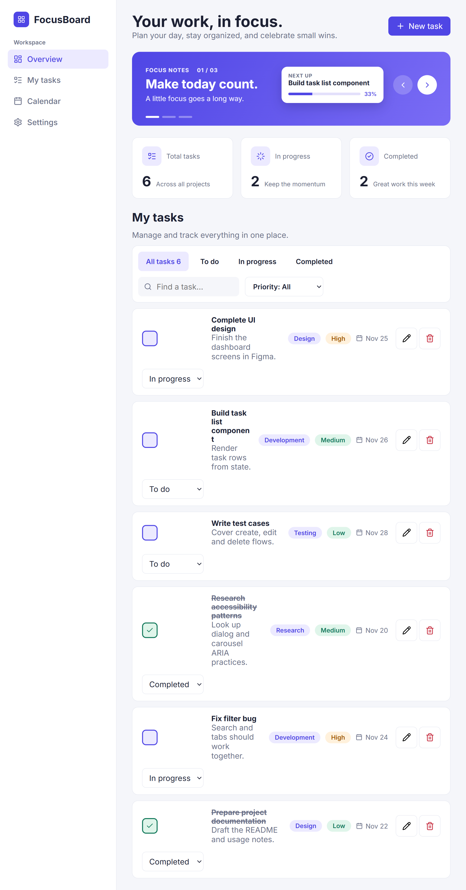
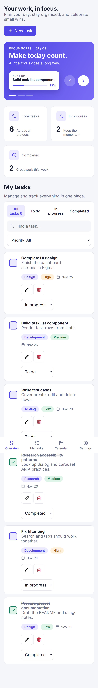

# FocusBoard

A responsive, single-user task dashboard built from a Figma design. Frontend only: no backend, login or database.

- **Live app:** https://focusboard-five-hazel.vercel.app/
- **Repository:** https://github.com/akanksha519/focusboard

## Tech stack
React 18, Vite, JavaScript, plain CSS, lucide-react (icons), localStorage.

## Features
- Create, edit and delete tasks (delete asks for confirmation)
- Statuses: To do, In progress, Completed. Change from the checkbox or the dropdown.
- Case-insensitive title search, status tabs and priority filter, all working together, plus Clear filters
- Statistics (total, in progress, completed, completion %) calculated from the task data
- Focus Notes carousel with three slides, previous/next buttons and indicators
- Tasks saved in localStorage and restored on refresh
- Responsive at 390, 768 and 1440 px, with a sidebar on desktop and a bottom navigation bar on small screens
- Semantic markup, labelled controls, visible focus outlines, keyboard-accessible dialogs

## Run locally
```bash
npm install
npm run dev
```
Production build: `npm run build`, then `npm run preview`.

## Project structure
```
src/
  components/   Sidebar, BottomNav, Header, FocusNotes, StatCard,
                SearchBar, FilterTabs, TaskList, TaskCard, TaskForm, ConfirmDialog
  data/         sampleTasks.js, focusNotes.js, navItems.js
  hooks/        useLocalStorage.js
  App.jsx       holds the state and combines the components
```

## State management
I used React hooks (`useState`) with a custom `useLocalStorage` hook, with no external state library. The data model is a single list of tasks, so a library would add complexity without benefit.

- **Single source of truth:** the `tasks` array lives in `App.jsx`. Every card, row, statistic and filter reads from it.
- **Updates without mutation:** add uses `[newTask, ...tasks]`, edit and status changes use `map` with `{ ...task, ...changes }`, and delete uses `filter`. Each returns a new array, so React re-renders.
- **Derived values:** the statistics, the filtered list and the empty-state message are calculated from `tasks` and the search, status and priority values on every render. They are not stored, so they cannot get out of sync.
- **Carousel:** `FocusNotes` keeps one piece of state, the active slide index. The slide, counter and indicators are all derived from it, and navigation wraps around.
- **Forms and dialogs:** `App` stores which task is being edited and which is pending deletion. The same `TaskForm` is used for create and edit.

## localStorage
`useLocalStorage` reads the saved tasks once, on first render, using a lazy `useState` initializer. If nothing is saved (`getItem` returns `null`), it uses the six sample tasks. A `useEffect` writes the tasks back whenever they change. Reads and writes are wrapped in `try/catch`, so corrupted or blocked storage falls back to the samples. Sample data never overwrites saved data, and an empty saved list stays empty.

## Limitations

- The sidebar and bottom navigation links are visual placeholders; there is only one screen.
- I added a "To do" tab that is not in the Figma tabs, so that all three statuses can be filtered.
- New tasks get the default category "General", because the Figma form has no category field.
- Data is stored per browser; there is no sync across devices.

## Screenshots

